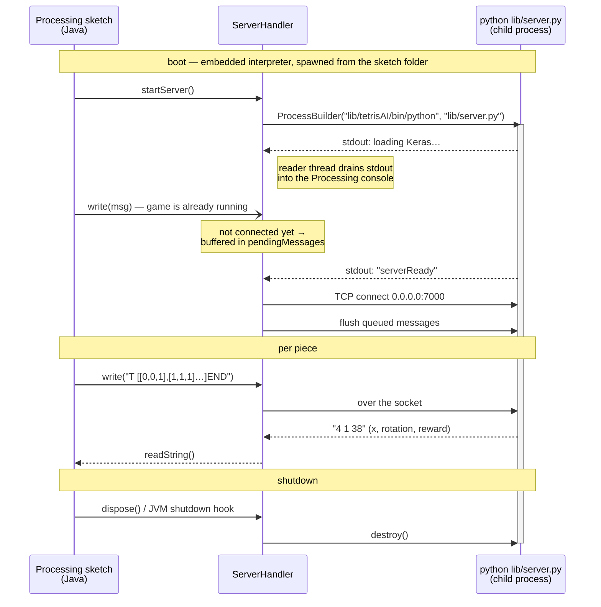
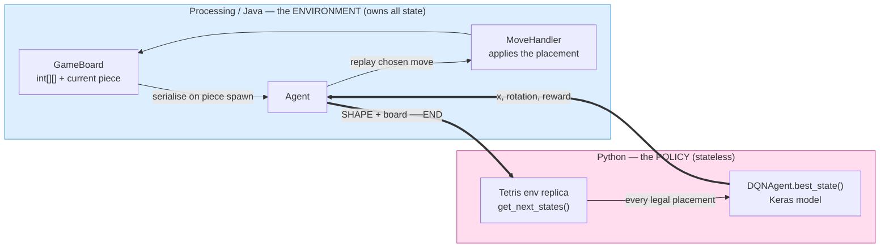
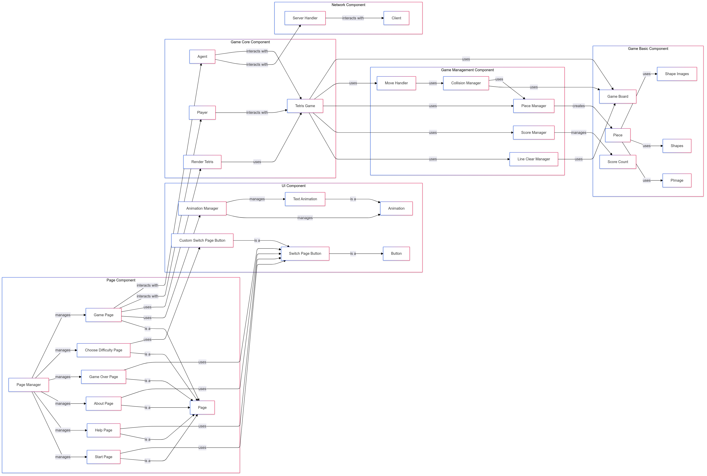

# TetrAI

A Tetris game built in **Processing 4** where you race a **Python deep-reinforcement-learning bot**.
The interesting part isn't the Tetris — it's that the sketch owns the Python process end to end: it
spawns it, waits for it to become ready, talks to it over a socket, and tears it down on exit.

## Download and play

The Python environment is **already inside the bundle**. No `pip`, no `venv`, no dependency install —
install Processing, open the folder, press Run.

| Platform | Download |
|---|---|
| Windows | [TetrAI (Windows)](https://drive.google.com/file/d/1_CELBGUG1l-ZR28EAitfSU56Nez66iVP/view?usp=drive_link) |
| Linux | [TetrAI (Linux)](https://drive.google.com/file/d/1HmdbGTIMcM3O70LXomeX9R4f4YxBRCVx/view?usp=drive_link) |

1. Install [Processing 4](https://processing.org/download) and the **Minim** library
   (*Sketch → Import Library → Manage Libraries…* → "Minim").
2. Unzip the bundle and open the folder in Processing.
3. Press **Run**.

## What this project demonstrates

- **[Bridging two languages locally](#the-bridge-processingjava--python)** — a Java program that
  supervises a Python child process and stays synchronised with it.
- **[Bridging an agent to an environment](#agent--environment)** — a third-party RL agent dropped in
  behind a text protocol, with no change to its learning code.
- **[Planned architecture and a pre-wrapped runtime](#packaging-the-environment)** — six layers designed
  up front, and a ~2 GB ML environment packaged so it runs with one click.
- **[A codebase a non-programmer can contribute to](#contributing-to-the-interface)** — the interface
  layer is four methods and drop-in asset files.

---

## The bridge: Processing/Java ↔ Python

All of this lives in [`serverHandler.pde`](serverHandler.pde).



**Process supervision.** `ProcessBuilder` starts the interpreter as a child process with
`redirectErrorStream(true)`, and a single-thread executor drains its stdout — so Python tracebacks and
logs surface in the Processing console instead of vanishing.

**The readiness handshake.** The socket can't be opened until Python has finished loading Keras and is
listening, which takes seconds. Rather than sleeping and hoping, the handler *watches the child's stdout*
for the line `serverReady` and only then constructs the `processing.net.Client`. Anything the game tries
to send before that is buffered in a `Queue<String>` and flushed the moment the connection opens — so the
game can start immediately and the race simply doesn't exist.

**Wire format.** Request `<SHAPE> <board-as-2D-list>END`, response `<x> <rotation> <reward>`. `END` is
the frame delimiter, because a TCP read doesn't respect message boundaries — one `recv` can hold two
requests or half of one.

**Lifecycle.** A `Runtime` shutdown hook plus `registerMethod("dispose", this)` destroy the child, so
closing the window never leaves an orphaned Python process holding port 7000.

> Known tradeoff: `lib/server.py` calls `eval()` on the incoming board string. That's why the port is
> meant for localhost only.

---

## Agent ↔ environment



**State lives on one side only.** Java owns the board; Python is handed one and returns a placement.
Because the contract is two lines of text, nuno-faria's DQN slotted in with **no change to its learning
code** — the only local edit was giving `Tetris.__init__` a `board=`/`piece_id=` constructor so an
environment can be built from a board that arrived over the wire.

Swapping in a different agent — a heuristic, a different model, another language entirely — means
reimplementing one function behind the same two-line protocol.

---

## Architecture



| Component | Classes | Responsibility |
|---|---|---|
| **Page** | `PageManager`, `Page`, `StartPage`, `HelpPage`, `AboutPage`, `ChooseDifficultyPage`, `GamePage`, `GameOverPage` | Screen routing; one active `Page` receives render / click / key events |
| **UI** | `Button`, `SwitchPageButton`, `CustomSwitchPageButton`, `Animation`, `TextAnimation`, `AnimationManager` | Reusable widgets and timed on-screen animations |
| **Game Core** | `TetrisGame`, `RenderTetris`, `Player`, `Agent` | One `TetrisGame` per side; `Player` is keyboard-driven, `Agent` is server-driven |
| **Game Management** | `MoveHandler`, `CollisionManager`, `PieceManager`, `ScoreManager`, `LineClearManager` | Movement/rotation legality, 7-bag piece generation, hold queue, line clears, scoring |
| **Game Basic** | `GameBoard`, `Piece`, shape tables, sprite images, score table | Plain data: the `int[][]` board, tetromino rotation states, assets |
| **Network** | `ServerHandler`, `processing.net.Client` | Spawns and supervises the Python process; queues messages until it is ready |

Dependencies point one way — pages depend on game core, game core on management, management on basic
data — and nothing depends upward. That's what makes the interface layer safe to work on in isolation.

---

## Packaging the environment

TensorFlow + Keras is a ~2 GB install and the most common place a reviewer gives up. So the environment
ships pre-built inside the download instead.

The constraint that shaped the layout: the interpreter is resolved as
`sketchPath() + "/lib/tetrisAI/bin/python"` — **relative to the sketch, never from `PATH`**. The
environment therefore travels with the project folder and nothing is installed system-wide.

There is exactly one spawn site and no OS detection in the codebase: the same embedded interpreter sits
at the same relative path in both the Windows and Linux bundles. Windows resolves the identical string
because `CreateProcess` appends `.exe` when the path has no extension.

---

## Contributing to the interface

You do not need a programming background to add or restyle a screen. There is no build step — edit a
`.pde` file and press Run.

**A screen is four methods.** Subclass `Page` ([`page.pde`](page.pde)) and fill in `init()`, `render()`,
`onClick()`, `onKeyPressed()`. `PageManager` handles everything else:

```java
class MyPage extends Page {
    SwitchPageButton backButton;
    PImage backgroundImage;
    PApplet app;

    MyPage(PApplet app) { this.app = app; }

    void init() {
        backgroundImage = loadImage("startPageBackground.png");   // just a file in data/
        backButton = new SwitchPageButton(
            width * 0.4, height * 0.7, width * 0.2, height * 0.12,
            "BACK", (app) -> new StartPage(app), app);            // destination named inline
    }

    void render()  { image(backgroundImage, 0, 0); backButton.render(); }
    void onClick() { if (backButton.isMouseOver()) backButton.onClick(); }
    void onKeyPressed(int key, int keyCode) { }
}
```

**Art and audio are drop-in.** Put a file in `data/` and call it by name: `loadImage("foo.png")`,
`minim.loadFile("bar.wav")`. Positions are written as fractions of `width`/`height`, so layouts scale
without touching any game logic.

```
├── main.pde              entry point
├── config.pde            all constants in one place — sizes, colours, port
├── page.pde              ← the Page contract + PageManager
├── *Page.pde             ← one file per screen: start, help, about, difficulty, game, game over
├── button.pde            ← buttons; animation.pde ← on-screen animations
├── data/                 ← all art, sound and fonts (drop-in)
│
├── tetris.pde            game loop + rendering        ┐
├── mapManage.pde         board, line clears, scoring  │ game internals —
├── moveHandler.pde       collision and movement       │ untouched when
├── pieceManager.pde      7-bag randomiser, hold       │ working on the UI
├── players.pde           Player (keys) / Agent (AI)   ┘
├── serverHandler.pde     the Java ↔ Python bridge
└── lib/
    ├── server.py         socket server
    ├── ai/               third party — see Credits
    └── tetrisAI/         the bundled Python environment
```

---

## Tech stack

Everything below is ours; `lib/ai/` is third-party — see [Credits](#credits).

| Layer | Technology |
|---|---|
| Game / rendering | **Processing 4** (Java 17+ dialect, `.pde`) |
| Networking | `processing.net` — `Client`, plus `java.lang.ProcessBuilder` for the child process |
| Audio | **Minim** (`ddf.minim.*`), a Processing contributed library |
| AI bridge | **Python 3.12**, standard library only (`socket`, `logging`, `pathlib`) |
| Assets | PNG/JPG sprites, WAV sound effects, Agave Nerd Font + Noto Sans TC |

---

<details>
<summary><strong>Build from source (Arch Linux)</strong> — only if you don't want the bundle</summary>

### 1. System packages

```sh
sudo pacman -S --needed jdk17-openjdk python python-virtualenv git
```

### 2. Processing 4

Not in the official repositories — install from the AUR (`yay -S processing`), or download the Linux
tarball from <https://processing.org/download> and put it on your `PATH` so `processing` and
`processing-java` are available.

### 3. The Minim audio library

**Sketch → Import Library → Manage Libraries…** → search **Minim** → *Install*.
(This lands in `~/sketchbook/libraries/minim/`; you can also place it there manually.)

### 4. The Python environment

> ⚠️ The environment **must** live at `lib/tetrisAI`. `serverHandler.pde` resolves the interpreter as
> `sketchPath() + "/lib/tetrisAI/bin/python"` — any other name or location will not be found.

```sh
cd /path/to/TetrAI
python -m venv lib/tetrisAI
lib/tetrisAI/bin/pip install --upgrade pip
lib/tetrisAI/bin/pip install -r lib/ai/requirements.txt
```

Check the backend starts on its own:

```sh
lib/tetrisAI/bin/python lib/server.py
# expected: WARNING:root:serverReady   (then it blocks on accept — Ctrl-C to stop)
```

### 5. Run

```sh
processing-java --sketch="$PWD" --run
```

Port **7000** must be free (set in `config.pde`). For CUDA training, install
`python-tensorflow-opt-cuda`; inference runs fine on CPU.

</details>

---

## Credits

### Team

| Name | Role |
|---|---|
| Ren-Jun Yao | Team leader · main programmer · schedule coordination |
| Tzu-En Peng | Lead art designer · programmer |
| Cheng-Yin Lu | Interface & art design support |
| Meng-Hsun Tsai | Programming support · code testing |
| Ting-Wei Lin | Program testing support |

### AI design — nuno-faria

The entire AI in **`lib/ai/`** is the work of **[nuno-faria](https://github.com/nuno-faria)**, vendored
from **<https://github.com/nuno-faria/tetris-ai>** and licensed under the **MIT License, © 2021
nuno-faria**. It is a deep Q-Learning agent that scores candidate successor board states rather than
actions. The upstream licence is kept verbatim at [`lib/ai/LICENSE`](lib/ai/LICENSE), the original
documentation at [`lib/ai/README.md`](lib/ai/README.md), and our local changes are listed in
[`lib/ai/ATTRIBUTION.md`](lib/ai/ATTRIBUTION.md).

### Also

Thanks to **Alexey Pajitnov** for inventing Tetris.
Fonts: [Agave Nerd Font](https://github.com/ryanoasis/nerd-fonts) and
[Noto Sans TC](https://fonts.google.com/noto/specimen/Noto+Sans+TC).
